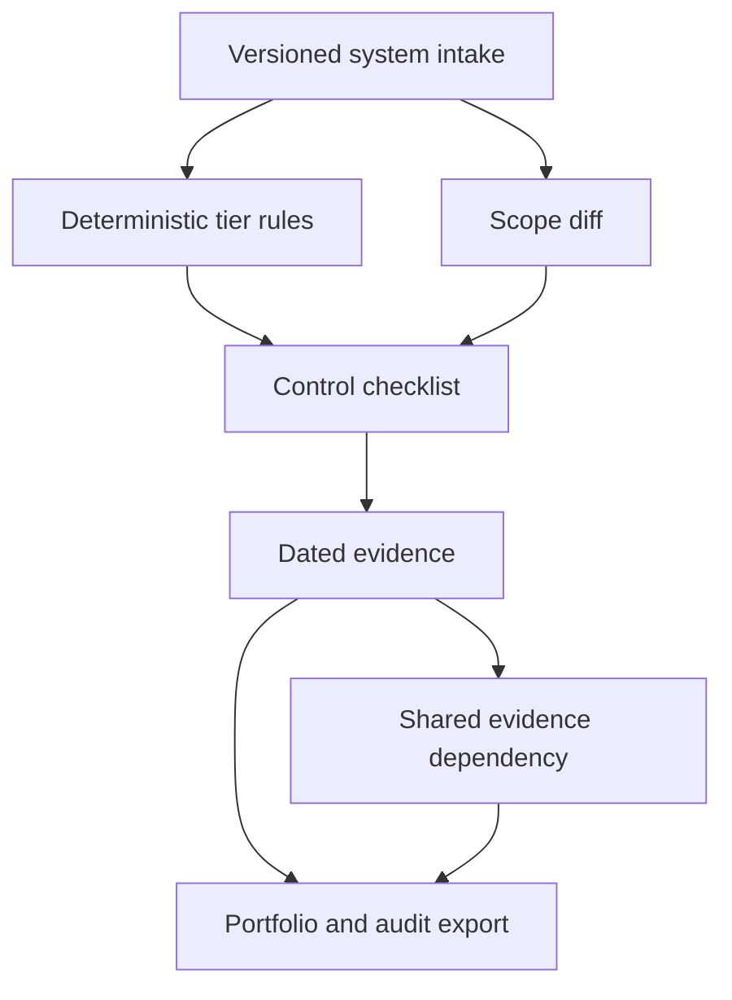

# ControlLedger

[](https://github.com/MadanMohan0537/ai-use-case-risk-registry/actions/workflows/ci.yml)

ControlLedger is a local, versioned inventory for AI systems. It converts structured intake into deterministic governance tiers, generates tier-specific control checklists, tracks dated evidence, shows portfolio completeness, and exports an audit-ready CSV.

> **Project Lab traceability:** catalog Project 09, originally “AI Use-Case Registry and Risk Tiering.” ControlLedger is the product name; this metadata prevents the renamed idea from being built twice.

## Implemented scope

- Structured intake for purpose, users, data, autonomy, decision impact, and domain.
- Deterministic `limited`, `elevated`, and `high` tiers with matched-rule explanations.
- Rule-version provenance on every classification.
- Tier-specific controls for ownership, logging, oversight, documentation, bias evaluation, and incident response.
- Evidence status: missing, current, or expired.
- SQLite version history and evidence store.
- Portfolio completeness view and CSV audit export.
- Five reproducible synthetic systems spanning all tiers.
- **P1 scope-change reclassification:** diff material fields and reopen relevant controls.
- **P2 shared control evidence:** reuse immutable evidence versions across systems, keep applicability explicit, and invalidate dependent claims on expiry or supersession.

Hosted UI, login, evidence uploads, jurisdiction-specific legal validation, reminders, and production security are planned—not implemented.

## Quick start

```bash
python -m venv .venv
source .venv/bin/activate
python -m pip install -e .
controlledger --json controlledger-report.json --csv controlledger-audit.csv
python -m unittest discover -s tests -v
```

No model, API key, network request, paid service, or private data is required.

## Workflow



## P1 experiment

The frozen fixture applies four material changes to a low-risk FAQ assistant: full automation, biometric data, a child audience, and benefits eligibility. All four must reopen linked controls; a version-only update must not. The test records the denominator, reopened count, and false negatives.

The fixture passes. This demonstrates workflow mechanics only—the rules remain illustrative until validated for a specific organization and jurisdiction.

## P2 experiment

The frozen dependency graph links five applicable system-control claims to two
shared platform artifacts. That avoids three duplicate submissions. A new
logging-evidence version supersedes three pinned claims, while an expired
incident-plan artifact invalidates two more. All five seeded stale dependencies
must be found, with applicability decisions stored independently from freshness.

The experiment passes with zero false negatives and one explicit
`not_applicable` exclusion. Reuse does not imply local applicability: every
link still requires a rationale, control match, and pinned evidence version.

## Demo

The demo registers five synthetic systems, classifies them across all three tiers, measures current-evidence completion, exports control denominators, and writes a CSV portfolio. Evidence completeness is intentionally low so missing governance work remains visible.

See [method and limitations](docs/METHOD.md) and the [rigorous backlog](docs/BACKLOG.md).

## License

MIT

