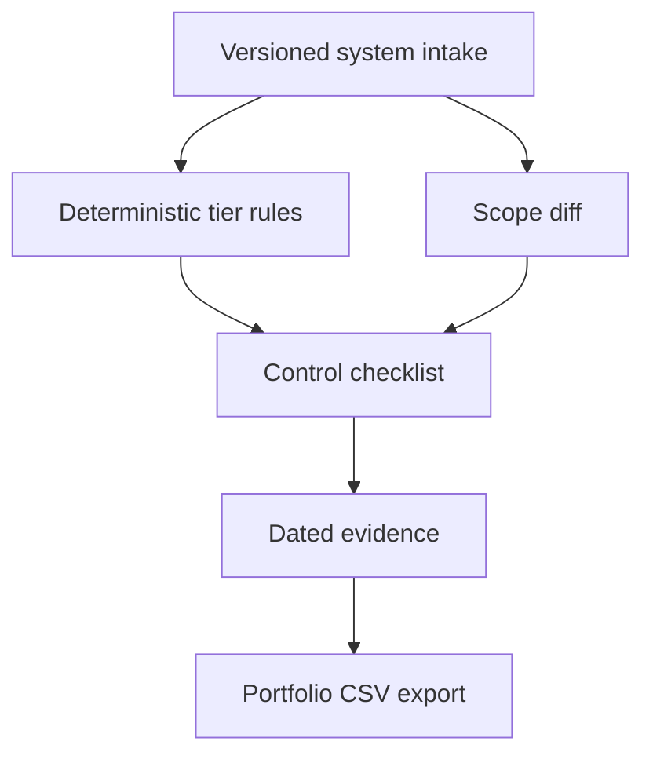

# AI Use-Case Risk Registry (ControlLedger)

[](https://github.com/MadanMohan0537/ai-use-case-risk-registry/actions/workflows/ci.yml)

**A local, versioned inventory of an organization's AI systems: deterministic risk tiers, tier-specific control checklists, dated evidence with expiry, and a CSV portfolio export.**

*Previously named `controlledger`. The Python package and CLI are still called `controlledger`.*

---

## The problem

As teams adopt AI tools, governance and IT leaders often can't answer basic questions: *Which AI systems do we run? Which are high-risk? Which required controls are missing or out of date? What changed since the last review?* Spreadsheets drift, and a small scope change (for example, adding biometric data) can silently move a system into a higher-risk category.

## Who it is for

AI/IT project managers, governance and risk leads, and product owners who need a lightweight registry before adopting a full governance platform.

## Approach

- **Structured intake** for purpose, users, data, autonomy, decision impact, and domain.
- **Deterministic tiers** (`limited`, `elevated`, `high`) with the matched rules explained and the rule version recorded on every classification.
- **Tier-specific controls** for ownership, logging, human oversight, documentation, bias evaluation, and incident response.
- **Evidence with dates**: each control is missing, current, or expired.
- **Scope-change reclassification**: diff material fields between versions and reopen only the affected controls.

## What exists today

- Intake, tiering, controls, evidence status, and a SQLite store for system versions and evidence. A unit test round-trips a saved system. Evidence save and load exist on the store and are not separately asserted. The demo CLI does not write to the store; it classifies fixtures in memory and writes JSON and CSV.
- Portfolio completeness in the JSON report, plus a CSV portfolio export (one row per system: tier, rule version, and controls current versus required).
- Five reproducible synthetic systems spanning all tiers.
- Scope-change experiment (below) and unit tests in CI (Python 3.11, 3.12, and 3.13).

**Not implemented:** hosted UI, login, evidence uploads, jurisdiction-specific legal validation, reminders, and production security. Shared-control reuse is on the [backlog](docs/BACKLOG.md) and is not built. That file is the list of planned work.

The tier rules are **illustrative**. They are not legal advice and they are not a determination under the EU AI Act, NIST AI RMF, or any jurisdiction.

## Quick start

Requires Python 3.11 or newer.

```bash
git clone https://github.com/MadanMohan0537/ai-use-case-risk-registry.git
cd ai-use-case-risk-registry
python -m venv .venv
source .venv/bin/activate
python -m pip install -e .
controlledger --json controlledger-report.json --csv controlledger-audit.csv
python -m unittest discover -s tests -v
```

The `controlledger` command writes those two files. Both names are gitignored. Stdout is a short summary: system count, tier counts, evidence completion, and required-control counts. The JSON file also contains the portfolio rows and the scope-change experiment.

Running the registry does not call a model, need an API key, use a paid service, or require private data. The tool itself makes no network request.

## Workflow



## Scope-change experiment

The demo applies four material changes to the `limited`-tier FAQ assistant: full automation, biometric data, a child audience, and benefits eligibility. All four reopen linked controls. A separate unit test checks that a version-only update does not. The experiment records `seeded`, `reopened` (changes that are material and reopen at least one control), and `false_negatives` (seeded changes that were not material). The unit test requires `seeded` to equal `reopened` and `false_negatives` to be zero.

The fixture passes. This demonstrates workflow mechanics only; the rules stay illustrative until validated for a specific organization and jurisdiction.

## Demo

The demo loads five synthetic systems, classifies them across all three tiers, measures current-evidence completion, exports how many controls each system requires, and writes a CSV portfolio. It does not persist those systems in SQLite. Evidence completeness is intentionally low — the synthetic run attaches current evidence to a single control — so missing governance work stays visible.

## How success should be measured (not yet measured)

- Share of an organization's AI systems registered and tiered.
- Share of required controls with current (unexpired) evidence.
- Time from a material scope change to reopened controls being reviewed.

See [method and limitations](docs/METHOD.md) and [backlog](docs/BACKLOG.md).

## Deployment

Cloudflare Workers is the planned deployment target. It is not configured yet, and this repository is not deployed. There is no `wrangler.toml`, no Worker entry point, and no live `workers.dev` URL.

When a Worker is configured, deploy it with:

```bash
npx wrangler deploy
```

Still needed before that command can run:

- a `wrangler.toml`
- a Worker entry point
- for this Python package, either Cloudflare Python Workers or a JavaScript/TypeScript port

## License

MIT
